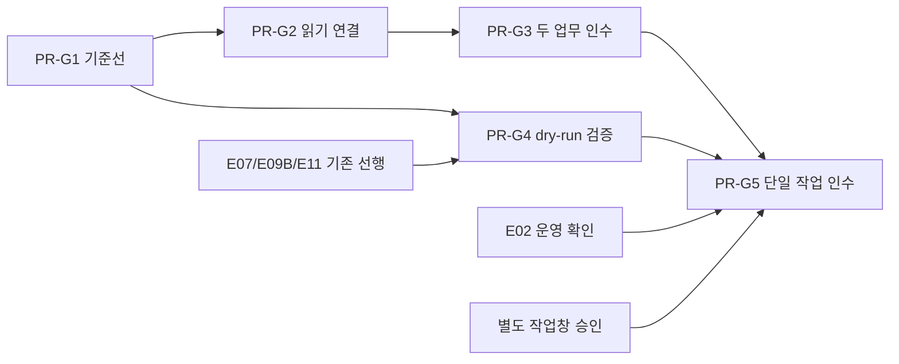

# Sangfor Engineer MCP — 기존 구현을 실제 업무 인수로 잇는 PR 계획

**Status: Draft — 계획입니다. 구현 완료·현장 인수·실행 승인이 아닙니다.**
기준일: 2026-11-04. 기준 main: `2c5679ad1bbfd706a186899d7bd313b63f30aa20`.
조율 기준: #142 병합 뒤의 기존 구현을 재사용합니다. 이번 문서는 문서 PR 한 건의 산출물입니다.
상위 추적: Refs #90, Refs #112. PR-G1~PR-G5는 계획 ID이며 GitHub PR 번호가 아닙니다.
정본: [제품명세](../product-specs/field-engineer-replacement.md), [기존 18단위 계획](engineer-workflow-delegation-plan.md), [보안](../SECURITY.md), [계획 규칙](../PLANS.md).
운영·담당 정본: Dev-wiki `decisions/2026-10-26-current-bot-operating-policy.md`를 따릅니다.

## 1. PRD — 무엇을 인수할 것인가

### 문제와 사용자
사용자는 고객 요구사항과 우선순위를 전달하고 가이드의 실용성과 고객 리스크를 판단합니다.
도구·검색·테스트가 존재하는 것과 실제 업무 한 건이 끝나는 것은 다릅니다.
이번 계획은 끊긴 수집 시작과 인수 증거를 보완하고, 이미 있는 기능을 다시 만들지 않습니다.
목표는 신뢰받는 Sangfor 엔지니어 1인의 업무입니다.
제품 전반의 L2 폭과 읽기 자문·진단의 L3 깊이를 함께 지향합니다.
제품 순서는 HCI, IAG, Endpoint Secure, Cyber Command입니다.
두 사례의 결과를 네 제품 전체의 자동화율로 확대하지 않습니다.
물리 작업, 비가역 변경, 고객 리스크 결정, 책임서명은 사람이 맡습니다.

### Phase A — 읽기와 가이드 인수
기존 환경 1건과 신규 구축 1건을 각각 끝까지 확인합니다.
기존 환경은 허가된 읽기 수집에서 시작하고, 신규 구축은 제공된 사양과 요구사항에서 시작합니다.
입력 → 코드 계산 → 현재/목표 차이 → 근거 있는 가이드 → 저장·재개 → Word를 같은 사례로 연결합니다.
PM이 가이드를 실제 작업 준비에 사용할 수 있는지 검토해야 현장 인수입니다.
공식 출처 없는 필수값은 미확인으로 남기며, 필수 미확인이 남으면 인수되지 않습니다.

### Phase B — 별도 승인된 단일 가역 작업
Phase A에서 검토한 가이드의 한 동작만 별도 작업창 승인 아래 수행합니다.
독립된 읽기 재조회(read-back)가 실제 전후 값과 승인 범위를 대조해야 성공입니다.
2xx, 클릭 성공, 문서 승인, dry-run 성공은 장비 변경 성공이 아닙니다.
`INDETERMINATE`는 성공이 아니며 자동 재시도·자동 롤백을 하지 않습니다.

### 인수 지표와 범위 밖
- 필수 요구사항 추적률은 100%입니다. 미확인 추적은 충족으로 세지 않습니다.
- 실행 가능한 가이드 단계의 값·출처·검증 방법 연결률은 100%입니다.
- 산술 결과는 독립 기대값과 수식별 고정 단위·반올림 기준 안에서 일치해야 합니다.
- 허위 PASS, 무승인 변경, 다른 scope 자료 노출은 각각 0건이어야 합니다.
- 자동 관측·수동 제공·미확인 필드 수와 비율을 따로 보고합니다.
- 무인 운영, 일괄 변경, 모델·RAG 엔진 교체, 자동 고객 발송은 제외합니다.
- 병합·배포·실장비 접근은 이 문서 작성으로 승인되지 않습니다.

### 상태와 값의 책임
`observed`는 실제 관측, `provided`는 제공값, `derived`는 코드 계산, `proposed`는 제안값입니다.
`unknown`은 0·false·정상으로 바꾸지 않습니다. 출처·단위·시각·제품·버전·scope를 보존합니다.
입력이나 관측 revision 변경은 의존 계산·가이드·승인을 stale로 만듭니다.
저장 실패는 미저장 상태이며, 저장 없는 승인·재개 성공으로 표시하지 않습니다.
개발 검증, 통합 검증, 현장 인수는 별개 상태입니다.
`fieldVerifiedAutoAllowed`는 해당 action의 실제 현장 근거를 요구하며 문서로 만들 수 없습니다.

## 2. 상세 개발계획 — 기준선과 재사용

현재 소스에는 사례 계약·요구사항·계산·차이 분석·가이드·Word·저장·UI·승인 연결이 존재합니다.
기존 18개 Issue는 진행·인수 추적 단위로 유지하고, 아래 5개 목표별 PR 묶음으로 재정리합니다.
열린 Issue가 있다는 이유로 기능 전체가 미구현이라고 가정하지 않습니다.
`startEngineerLiveCollect`는 intake가 complete여도 `LIVE_COLLECT_INTAKE_COMPLETE_NOT_STARTED`를 반환합니다.
현 소스는 이 경우 collect/fetch를 호출하지 않습니다. 이를 실제 수집 완료로 읽지 않습니다.
공식 Janus 단일 호스트 CPU/RAM 변환은 `collect-extras.ts`에 이미 있습니다.
다중 호스트, usable storage, network topology, HA는 별도 근거와 매핑이 필요합니다.
기존 `inventory.ts`의 volumes/servers/images를 전체 구축 관측값으로 확대하지 않습니다.
과거 CI run `36157070501`의 1 fail / 3576 pass / 102 skip은 역사적 기록입니다.
이 문서 작성에서 재실행한 결과가 아니며 현재 실패 원인이나 현재 테스트 수를 뜻하지 않습니다.

## 3. PR-G1 — 기준선 회귀와 문서·PR 정합성

- 목표: #104/#112의 회귀 차단을 재현하고, 현재 소스와 추적 문서의 불일치를 최소 수정합니다.
- 선행: main 기준과 #142 반영 범위를 고정하고 기존 실패·거절·수리 예산 기록을 인계받습니다.
- 재사용: `tests/authority-manifest-lock.test.ts`와 repository census의 의미 기반 digest 계약입니다.
- 예상 수정 파일(제안): `packages/sangfor-authority/src/repository-census*.ts`, 해당 lock 테스트입니다.
- lock 후보: `packages/sangfor-authority/authority-manifest.lock.json`은 원인 확인 뒤에만 검토합니다.
- 문서 후보: 기존 위임 계획과 상태 문서 중 사실이 달라진 부분만 수정합니다.
- 순서: exact head에서 실패 assertion·기대/실제 digest·census 입력 차이를 먼저 보존합니다.
- AST 분류·포함 파일·정규화와 실제 authority 의미 변경을 구분해 원인을 좁힙니다.
- 의미가 바뀌지 않았다면 분류/정규화의 최소 수리를 우선합니다.
- 의미 변경이 맞다면 소유권·분류·의존 경계 검토와 독립 승인 근거를 붙여 lock 변경을 검토합니다.
- lock을 무조건 refresh하거나 기대값을 실제값에 맞추는 수리는 금지합니다.
- 기존 명령: `pnpm test -- tests/authority-manifest-lock.test.ts tests/authority-repository-census.test.ts`.
- 추가할 시험 행동: 무관한 소스 변화와 authority 의미 변화를 구분하고 후자만 digest에 반영하는지 확인합니다.
- 음성·경계: 외부 census, 위조 manifest, 중복 소유, aggregate 추가, 변경 lock은 계속 거절해야 합니다.
- 문서 검사: Issue별 코드·시험·남은 인수를 비교하고 PR 본문의 지원 범위를 일치시킵니다.
- 제외: 회귀 해결을 위한 gate 완화, skip 추가, 기능 재작성, 현장 인수 선언입니다.
- 종료증거: 원래 실패 재현, 원인 설명, 최소 diff, 새 회귀 결과와 공통 명령의 실제 출력입니다.
- 담당: 코드 수정·제품 PR 제출은 가재군입니다. 검증자는 PR당 1명을 조율하며 아직 배정하지 않았습니다.
- 검증경계: 문서와 fixture 일치는 live 지원 증거가 아닙니다. 원인 미재현이면 해결로 표시하지 않습니다.

## 4. PR-G2 — 허가된 읽기 시작과 필수 관측면 연결

- 목표: #95/#96/#105의 기존 intake에서 허가된 live GET까지 연결하고 필수 관측값을 보존합니다.
- 선행: G1 기준선 검증, E01 계약 확인, E02/#94의 현장 접근 운영 확인입니다.
- 재사용: intake, 기존 collector, `engineer-collect-bind.ts`, 승인·현장 인수 grant를 그대로 사용합니다.
- 예상 수정 파일(제안): `packages/sangfor-hci-client/src/engineer-live-collect-start.ts`, `inventory.ts`입니다.
- 추가 후보: 같은 디렉터리의 `janus-hosts-adapter.ts`, `collect-extras.ts`, `required-observations.ts`입니다.
- binder 후보: `packages/sangfor-config-state/src/engineer-collect-bind.ts`; 새 범용 수집기는 만들지 않습니다.
- 순서: 승인된 target/origin/제품/firmware/읽기 범위/보관 범위를 고정한 뒤 GET 전용 호출을 연결합니다.
- 기존 complete-but-NOT_STARTED 시험은 현 기준선으로 보존하고 새 성공·거절 계약을 분리해 갱신합니다.
- 단일 호스트 CPU/RAM 매핑은 재사용합니다. 다중 호스트를 무조건 합산하지 않습니다.
- usable storage·network·HA는 공식 문서와 실제 응답의 의미를 확인한 adapter만 추가합니다.
- 공식 근거·응답이 없으면 unsupported/미확인으로 남기며 endpoint나 필드를 추측하지 않습니다.
- 기존 명령: `pnpm test -- tests/engineer-live-collect-intake.test.ts tests/engineer-hci-collection.test.ts`.
- 기존 명령: `pnpm test -- tests/engineer-janus-hosts-adapter.test.ts tests/engineer-required-observations.test.ts tests/engineer-collect-bind.test.ts`.
- 추가할 시험 행동: 완전한 허가 입력은 지정 GET만 호출하고 원자료 digest와 관측 출처를 binder에 전달합니다.
- 추가할 시험 행동: GET 성공만으로 `field_accepted`를 부여하지 않고 기존 독립 인수 grant를 요구합니다.
- 음성·경계: intake 누락·다른 origin·오래된 권한·잘못된 firmware·부분 페이지·빈 응답·충돌 값을 거절/미확인으로 남깁니다.
- 음성·경계: 다중 호스트·MB/GiB·물리총량/가용량 혼동과 임의 target 변경을 검증합니다.
- 제외: 실제 쓰기, 새 인증/승인 체계, 전체 제품 수집 지원, 비공개 원본의 공개 저장입니다.
- 종료증거: fixture 회귀와 허가된 실제 GET 영수증, 필수 필드별 독립 대조표, 변경 dispatch 0건입니다.
- 담당: 구현·제출은 가재군이며 독립 검증자는 PR당 1명으로 조율합니다.
- 검증경계: fixture 성공은 live 성공이 아닙니다. 장비/권한 부재는 NOT_RUN이며 현장 인수는 미완료입니다.

## 5. PR-G3 — 두 실제 업무의 전체 가이드 인수

- 목표: #104/#105의 기존 환경 1건과 신규 구축 1건을 입력부터 Word·재개까지 같은 revision으로 인수합니다.
- 선행: G2 관측 연결, 기존 E04~E11의 계약·저장·UI·출력 검증을 확인합니다.
- 재사용: `packages/sangfor-sizing/src/engineer-calculations.ts`, 기존 요구사항·차이 분석·가이드 builder입니다.
- 예상 수정 파일(제안): `tests/engineer-workflow-e2e.test.ts`, `tests/support/engineer-workflow-pipeline.ts`입니다.
- 후보: `apps/operator-console/src/engineer-case-api.ts`, `engineer-case-guide.ts` 및 기존 UI 사례 파일입니다.
- 후보: `packages/sangfor-planner/src/engineer-guide.ts`, `packages/sangfor-product-adapters/src/engineer-guide-export.ts`입니다.
- 저장 후보: `packages/sangfor-authority/src/engineer-case-persistence.ts`; 저장 계층을 새로 만들지 않습니다.
- 순서: 비공개 원본은 안전 저장소에 두고 익명화 manifest·요구사항·독립 기대값을 먼저 고정합니다.
- 입력·계산·차이·가이드·저장·재개·Word의 사례 ID와 revision 및 핵심 값을 대조합니다.
- 산술은 코드로 검산합니다. 개발 출력에서 기대값을 복사하거나 LLM 산술을 판정자로 쓰지 않습니다.
- RAG는 검색 적중과 별개로 출처·제품·버전·답변 내용·가이드 적용 가능성을 독립 내용 검토합니다.
- 기존 명령: `pnpm test -- tests/engineer-workflow-e2e.test.ts tests/engineer-calculations.test.ts tests/engineer-guide-grounding.test.ts`.
- 기존 명령: `pnpm test -- tests/engineer-case-api.test.ts tests/engineer-case-persistence.test.ts tests/engineer-guide-export.test.ts`.
- 기존 명령: `pnpm run test:ui` 및 `pnpm run test:postgres:mandatory`를 각각 정해진 격리 환경에서 수행합니다.
- 추가할 시험 행동: 두 사례의 독립 oracle과 API/UI/Word 값을 비교하고 재시작 뒤 같은 저장 revision을 복구합니다.
- 음성·경계: 원본 부재·stale 증거·다른 제품/버전·GB/GiB·0 분모·누락을 정상으로 채우지 않습니다.
- 음성·경계: DB 장애·부분 저장·동시 revision 충돌·다른 tenant 다운로드·악성 문서를 검증합니다.
- 제외: DOCX 열기만으로 내용 인수, synthetic을 실제 업무로 표시, 자동 고객 발송입니다.
- 종료증거: 두 실제 사례의 요구사항 추적표, 독립 산술표, RAG 내용 검토, 재개·Word 대조와 PM 인수 기록입니다.
- 담당: 구현·제출은 가재군, 독립 검증 1명은 조율 대상이며 PM은 가이드 사용성과 리스크를 검토합니다.
- 검증경계: 필수 미확인은 해결 또는 미인수로 남깁니다. 원본/현장 부재를 개발 시험으로 대체하지 않습니다.

## 6. PR-G4 — 가이드 결합 dry-run과 검증 결과 소비 점검

- 목표: #106의 기존 guide revision 결합 dry-run을 재검증하고 검증 응답이 성공으로 오독되는지 점검합니다.
- 선행: G1과 기존 E07/#100, E09B/#108, E11/#104입니다. E12 현장 인수를 기다릴 필요는 없습니다.
- 재사용: 기존 guide digest, action-bound 승인, nonce, remote-job 권한과 dry-run 경로입니다.
- 예상 수정 파일(제안): `apps/mcp-server/src/engineer-guide-bound-dry-run.ts`와 관련 기존 시험입니다.
- 후보: `apps/control-tower/src/tower-guide-dry-run-api.ts`, `packages/sangfor-product-adapters/src/operator/engineer-guide-apply-bind.ts`입니다.
- 소비 점검 후보: `apps/mcp-server/src/operator-session-tool-catalog.ts`, `packages/sangfor-verifier/src/index.ts`와 실제 호출자입니다.
- `sangfor_verify_result`의 정적 `ok`가 최종 PASS로 소비되는지는 점검 대상이며 결함 확정이 아닙니다.
- 순서: handler에서 소비자·화면·저장·승인 상태까지 추적하고 manual checklist와 독립 read-back을 구분합니다.
- 오독이 재현될 때만 실패 시험을 고정하고 해당 소비 경로를 최소 수정합니다.
- 기존 명령: `pnpm test -- tests/mcp-engineer-guide-dry-run.test.ts tests/control-tower-engineer-guide-dry-run.test.ts`.
- 기존 명령: `pnpm test -- tests/engineer-guide-apply-bind.test.ts tests/engineer-guide-apply-file.test.ts tests/write-authorization-authority.test.ts`.
- 추가할 시험 행동: checklist/정적 ok·verify 미실시·같은 mutation 응답 재활용은 최종 PASS가 되지 않게 합니다.
- 추가할 시험 행동: 저장된 guide revision·digest·target·변경값과 승인된 proposal의 동일성을 확인합니다.
- 음성·경계: 오래된 가이드·입력 수정·nonce replay·만료/위조 승인·wrong scope·사전 상태 drift를 거절합니다.
- 음성·경계: dispatch 후 응답 유실·독립 재조회 실패/불확실은 non-PASS를 유지합니다.
- 제외: 실제 쓰기 활성화, 새 승인 시스템, 단순 응답 이름만 바꾸는 수리, 현장 증거 생성입니다.
- 종료증거: 호출 경로 대조, 오독 재현 또는 미확인 범위, dry-run/거절 시험 출력과 실제 mutation 0건입니다.
- 담당: 구현·제출은 가재군이며 독립 검증자는 PR당 1명을 조율합니다.
- 검증경계: dry-run 통과는 Phase B 개발 증거일 뿐 실장비 인수가 아닙니다.

## 7. PR-G5 — 별도 승인 단일 가역 작업과 독립 재조회

- 목표: #107의 정확한 한 제품/firmware/target/action만 현장 인수합니다.
- 선행: G3/E12/#105, G4/E13/#106, E02/#94 운영 확인 및 별도 작업창 승인입니다.
- 재사용: 기존 evidence campaign/promotion, 실행 gate, 독립 read-back, nonce·감사 영수증입니다.
- 예상 수정 파일(제안): 기존 현장 인수 증거 문서와 JM/BLRO runbook의 해당 절차만 보완합니다.
- 후보: `docs/references/engineer-workflow/`의 비밀 없는 인수 요약입니다. 원본은 비공개 저장소에 둡니다.
- 순서: action·값·대상·시간·중지/복구 조건과 현재 권한을 새 승인에 묶어 확인합니다.
- 사전 `fieldVerifiedAutoAllowed` 근거가 없으면 ordinary live dispatch를 금지합니다.
- 첫 현장 근거는 기존 전용 bootstrap 계약과 별도 승인으로만 수집합니다. 새 bypass는 만들지 않습니다.
- 현재 전용 bootstrap은 제한된 O1 IAG lab/non-production 가역 예외이며 HCI 전체로 확대하지 않습니다.
- 전용 조건·공식 근거·두 실행 flag·단일 사용 승인·mock 음성 근거가 부족하면 NOT_RUN/REFUSED입니다.
- bootstrap 결과는 candidate-only이며 자동 성숙도 승격이나 다음 작업 권한이 아닙니다.
- 독립 읽기 재조회는 별도 권한·작업 식별자로 전후 값과 범위를 검증합니다.
- 기존 명령: `pnpm test -- tests/iag-bootstrap-gate.test.ts tests/iag-evidence-bootstrap-runner.test.ts tests/iag-bootstrap-authority-recheck.test.ts`.
- 기존 명령: `pnpm test -- tests/write-authorization-authority.test.ts tests/engineer-field-acceptance.test.ts`.
- 추가할 시험 행동: 사전 현장 근거 없는 ordinary 경로의 dispatch가 0이고 전용 계약만 별도 승인으로 진입하게 합니다.
- 음성·경계: wrong origin·firmware·action·시간창·위조 evidence·이미 활성 promotion은 mock에서 거절합니다.
- 현장 절차: 승인된 가역 action 1회와 별도 독립 재조회만 수행하고 고의 장애를 주입하지 않습니다.
- 불확실하면 중지·증거 보존·사람 확인으로 끝냅니다. 자동 재시도/자동 롤백은 금지합니다.
- 필요한 원복은 별도 승인된 작업입니다. 성공·실패·불확실·미실행을 따로 집계합니다.
- 제외: 다장비 적용·무인 운영·파괴적 변경·제품 전체 자동화 완료 선언입니다.
- 종료증거: 정확한 승인 범위, 실제 dispatch, 독립 read-back, 접근 정리 및 PM 인수의 연결 영수증입니다.
- 담당: 제품 수정·제출은 가재군, 현장 승인은 PM, 독립 검증 1명은 PR별 조율 대상입니다.
- 검증경계: 장비·승인 부재는 blocked_external이며 성공이나 프로그램 종료로 바꾸지 않습니다.

## 8. 의존관계·담당·제출 계약

G1 뒤 쓰기 경로가 겹치지 않는 G2/G4 준비는 병렬로 진행합니다.
공유 계약·시험·승인 파일을 바꾸면 한 담당자가 먼저 확정하고 후속 변경을 순차 반영합니다.
개발 PR은 가재군이 맡습니다. 도리·디노·Cursor 중 검증 1명을 PR마다 조율합니다.
위 역할표는 배정 완료나 실행 접수 증거가 아닙니다. 기존 작성자의 경계를 유지합니다.
각 PR 본문은 목표, base/head, Refs Issue, 재사용/수정, 제외, 명령/출력, 남은 인수를 적습니다.
이 계획만으로 #90/#112를 자동 close하지 않습니다. 인수 전에는 `Refs`를 사용합니다.
후속 #47/#54/#55/#57–#60/#67–#71은 보존하고, closed #88을 다시 만들지 않습니다.
기존 실패·거절·남은 수리 예산은 새 이름의 작업으로 초기화하지 않습니다.

## 9. 검증·증거와 이번 문서의 한계

각 제품 PR의 최종 head에서 `pnpm test`, `pnpm run lint`, `pnpm run build`를 다시 실행합니다.
관련 통합 gate는 `pnpm run smoke:mcp`, `pnpm run check:browser-boundary`, `pnpm run check:data-scope-boundary`, `pnpm run check:hygiene`입니다.
DB 검증은 `pnpm run test:postgres:mandatory`로 별도 수행하며 일반 시험 통과로 대신하지 않습니다.
영수증에는 base/head, 환경, 시각, 명령/절차, exit, pass/fail/skip/NOT_RUN, fixture/live, digest, scope, 미확인, 실행자·검증자를 기록합니다.
공개 문서에는 비밀·실장비 주소·private-store 값을 넣지 않고 비공개 원본의 불투명 참조만 사용합니다.
이번 작성은 지침·기존 계획·소스·package scripts를 읽고 문서만 변경한 작업입니다.
현재 환경에서 full TypeScript 시험·lint·build는 미실행입니다. 원인이나 실행 결과를 새 관측 없이 단정하지 않습니다.
실장비 GET/변경, DB 접속, runtime 변경, 설치, commit, GitHub 제출은 이번 작성 범위에 없습니다.
문서 검사 결과는 별도 실제 출력으로 반환하며 제품 구현·현장 인수를 증명하지 않습니다.
